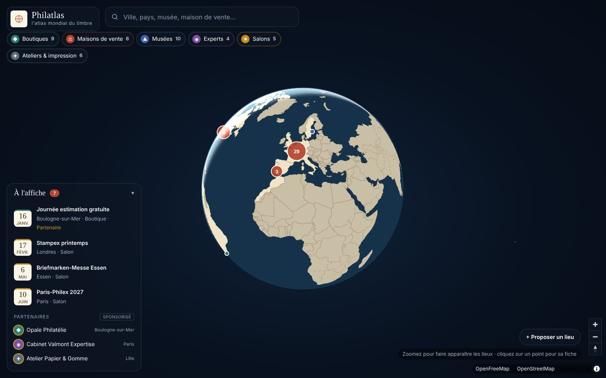
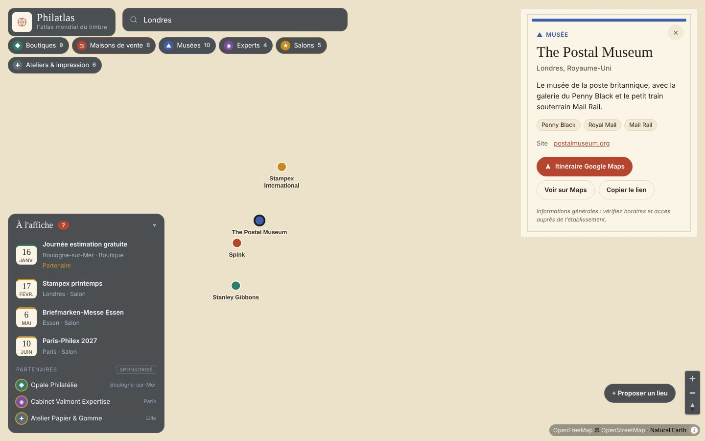
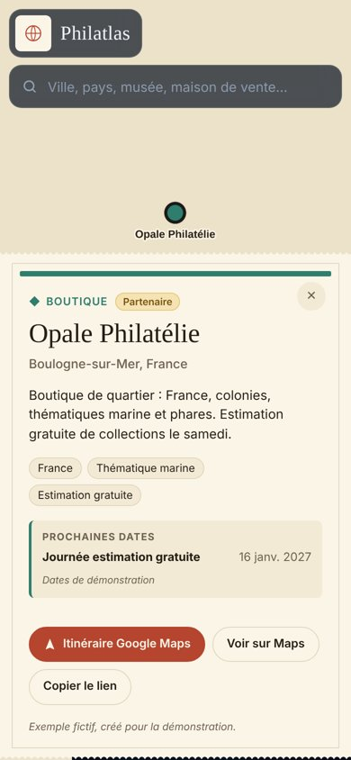

# Philatlas — l'atlas mondial de la philatélie

> Découvrir les lieux du timbre à travers un globe interactif 3D : boutiques, maisons de vente, musées, experts, salons, ateliers de restauration et d'impression.



L'idée n'est pas de concurrencer Google Earth, mais de proposer un **atlas spécialisé** : on fait tourner le globe, on zoome sur une région, les lieux apparaissent, on ouvre leur fiche, et un clic lance l'itinéraire dans Google Maps.

## Fonctionnalités

- **Globe 3D interactif** (projection globe), avec rotation automatique tant que personne n'y touche. Il s'arrête à la première interaction et reprend après 25 s d'inactivité.
- **Détail chargé uniquement là où l'on regarde** : les contours des pays (~100 Ko) sont embarqués. Les rues, l'eau, les parcs et les bâtiments arrivent en tuiles vectorielles à partir du zoom 4, seulement pour la zone affichée. Les pays où figurent des lieux sont mis en valeur comme « zones d'intérêt ».
- **Les points apparaissent au zoom** : de loin, des bulles regroupent les lieux par zone (cliquer dessus zoome). De près, chaque lieu a son point, sa couleur de catégorie, puis son nom.
- **Recherche** par ville, pays ou établissement, insensible aux accents (« geneve » trouve Genève). Elle cherche aussi dans les spécialités (« penny » trouve le Postal Museum) et se pilote au clavier (`/` pour chercher, flèches, Entrée).
- **Fiches détaillées** au style de timbre dentelé : catégorie, description, spécialités, prochaines dates, adresse et site.
- **Itinéraire Google Maps en un clic**. Le lien vise le nom et l'adresse de l'établissement, plus fiable qu'un point GPS approximatif.
- **Filtres** par catégorie : un clic isole une catégorie, les suivants en ajoutent.
- **Agenda « À l'affiche »** des salons, ventes et journées spéciales à venir.
- **Lien partageable** vers chaque fiche (`#lieu=musee-poste-paris`).
- **Responsive** : sur mobile, la fiche s'ouvre en bas d'écran et les filtres défilent.

### Prêt pour le modèle économique

- **Référencement premium** : contour doré sur le globe, badge « Partenaire », priorité dans la recherche, présence dans l'encart « Partenaires ».
- **Publicité discrète** : l'encart est clairement étiqueté « Sponsorisé », et les événements des partenaires remontent dans l'agenda.
- **« Proposer un lieu »** : formulaire de référencement gratuit, qui sert de porte d'entrée vers l'offre partenaire.

<table><tr>
<td></td>
<td width="28%"></td>
</tr></table>

## Technique

| | |
|---|---|
| Globe | [MapLibre GL JS](https://maplibre.org) 6, projection `globe`, atmosphère |
| Fonds de carte | Contours Natural Earth embarqués + tuiles vectorielles [OpenFreeMap](https://openfreemap.org) (gratuites, sans clé d'API, sans quota) |
| Application | TypeScript strict, sans framework : léger et rapide |
| Tests | Vitest : recherche, liens Google Maps, agenda, cohérence des données |
| Hébergement | Site statique sur Cloudflare (CDN mondial, gratuit) |

**Coût de fonctionnement : zéro.** Aucune clé Google Maps n'est nécessaire, puisque l'itinéraire passe par une simple URL publique. Les tuiles OpenFreeMap sont gratuites et l'hébergement statique aussi.

```
src/
├── data.ts    # lieux, catégories, pays (à remplacer par une API / base de données)
├── core.ts    # logique pure et testée : recherche, liens, agenda, GeoJSON
├── map.ts     # globe, couches, regroupements, rotation, cadrages
└── main.ts    # interface : recherche, filtres, fiches, agenda, formulaire
```

## Lancer en local

```bash
npm install
npm run dev      # http://localhost:5173
npm test
```

## Déployer (Cloudflare, gratuit)

```bash
npx wrangler login
npm run deploy
```

## Données de démonstration

Les institutions réelles (musées, maisons de vente, salons, imprimeurs) n'ont que des informations générales, sans horaires ni téléphone. Les boutiques, experts et ateliers marqués « exemple fictif » sont inventés pour illustrer les catégories et l'offre partenaire. **Toutes les dates d'événements sont des dates de démonstration.**

## Pistes pour la suite

- [ ] Back-office : ajout et validation des lieux, gestion des partenaires et des dates
- [ ] Base de données et API (Cloudflare D1 + Workers), avec chargement des lieux par zone visible pour tenir des dizaines de milliers de points
- [ ] Comptes professionnels et paiement de l'offre premium (Stripe)
- [ ] Multilingue (anglais, allemand…), indispensable pour une plateforme mondiale
- [ ] Avis de collectionneurs, photos des lieux, horaires d'ouverture

---

Réalisé par **Joël Broutin**, développeur web freelance. [Portfolio](https://as9ardth0r.github.io/portfolio/)

Licence MIT pour le code. Données cartographiques © OpenStreetMap contributors, OpenFreeMap, Natural Earth.
